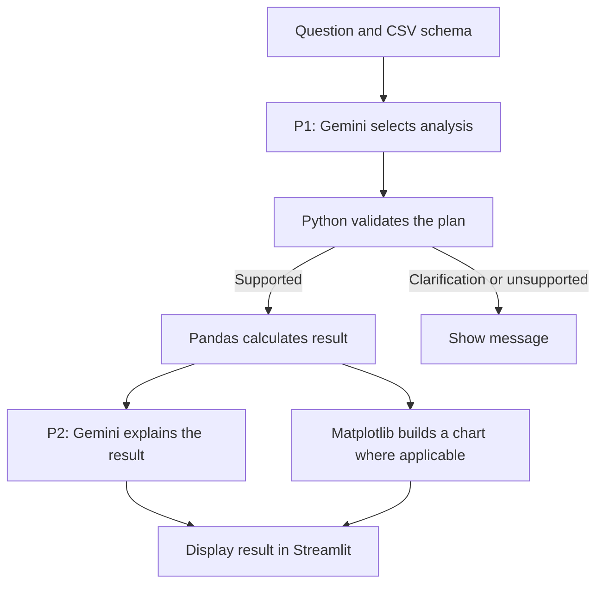

# Solution design

## Prompt workflow

## Task decomposition

| Task | Component |
|---|---|
| Load and preview the CSV | Streamlit and Pandas |
| Interpret the question | Gemini analysis-plan prompt |
| Validate and execute the plan | Python and Pandas |
| Explain the result | Gemini result-explanation prompt |
| Display figures | Matplotlib and Streamlit |

## Input and output

Input: a CSV and a natural-language question. Output: a plain-English answer with the computed result and an optional chart, or a clarification or unsupported message.

## System architecture

The Streamlit frontend calls the shared Python module. The module sends the question and schema to Gemini for a plan, validates the plan locally, and runs the selected Pandas operation. It sends the computed evidence to Gemini for a short explanation and gives the result and optional figure back to the frontend.
